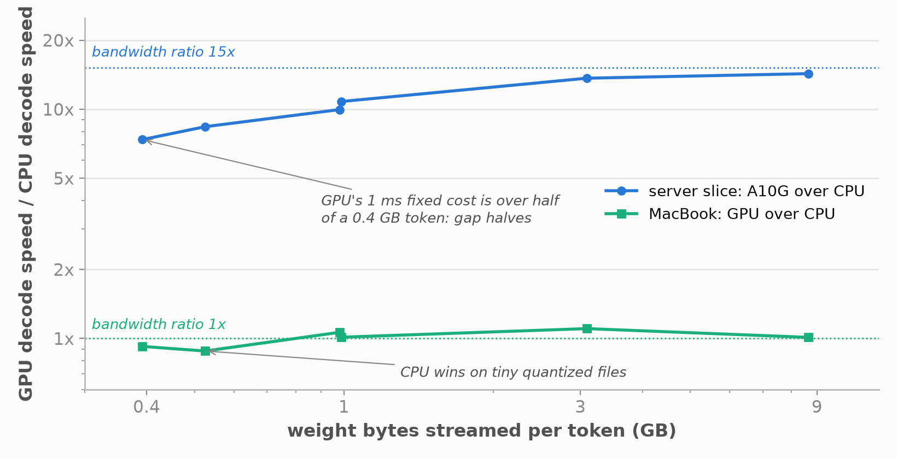

*Part 10 of "The Inference Wall", the second half of the CPU study: Qwen3.5-4B and two
smaller models on a cloud server slice and a MacBook with an M4 Pro chip, each with its
own GPU alongside.*

*Manas Pathak · November 5, 2026*

[The Inference Wall]({{ '/' | relative_url }}) · [All posts]({{ '/articles/' | relative_url }}) · **Part 10**

[Part 9]({{ '/articles/part-9/' | relative_url }}) carried the series' claim onto two
CPUs and found it held: for one user, the time to produce a token is the model's bytes
divided by the memory bandwidth, plus a fixed cost per token, and on a 4B model the first
term is nearly the whole token on both machines. This part is about the second term, the
one Part 9 set aside.

```
time per token  =  weight bytes / memory bandwidth  +  fixed cost per token
```

On the server slice, reading the 4B model's weights takes about a quarter of a second for
every token, so any cost that does not depend on the model's size is too small to notice.
On the MacBook the same read is about seven times faster, and the things it used to hide
start to show. Every token carries a fixed cost of about a millisecond, which matters once
a model is small. Compressed weight formats need extra arithmetic to unpack, and an earlier
measurement mistook that for the fixed cost. The gap between CPU and GPU shrinks as models
get smaller. And on a machine whose CPU and GPU share one memory, two common rules of thumb for using the GPU turn out to work the opposite way from a
machine with a separate GPU. Along the way the post lays out the evidence behind an
answer Part 9 stated, that the MacBook is fast because of its memory rather than its CPU.

## What the fast machine makes visible


Part 9 measured the MacBook with the same model stored four ways, at 4, 6, 8, and 16 bits
per weight, called Q4, Q6, Q8, and F16. It drew a straight line through the results and
read the memory bandwidth off its slope. Where that line meets zero bytes is the fixed
cost per token, and the fit put it at about 4.6 ms for the CPU and 2.4 ms for the GPU,
which made the GPU look cheaper per token, but that turned out to be wrong. The smaller
models below, measured with the format held fixed, put the fixed cost at about 1 ms on
both. The difference most likely comes from a cost the two-term equation
leaves out.
Compressed weights have to be unpacked before they can be used, which takes extra work for
every byte, so the Q4 and Q8 points run a little slower than the line through the F16
points. In Part 9's measurements the format and the file size changed together, so that
unpacking cost was counted as fixed cost.

The same small costs explain a pattern from Part 9. On the server slice, reading 3 GB of
Q4 weights takes about 91 ms per token, so a few extra milliseconds of fixed cost and
unpacking barely register. Speed times bytes, the effective bandwidth, therefore comes out
nearly the same for every format: 34, 32, and 30 GB/s for bf16, Q8, and Q4, all close to
the 33 GB/s the memory can deliver. The MacBook reads the same 3 GB in about 14 ms, while the extra milliseconds stay the same
size, so they become a noticeable share of each
token. Effective bandwidth then varies with the format, from 157 GB/s for Q4 to 188 GB/s
for F16 on the CPU. The faster the memory, the more these small costs matter and the more
they are worth optimizing, and measuring them means comparing models in the same weight
format, since changing format and size together hides one cost inside the other.

## Does model size change the gap?

If reading the weights is nearly the whole token, model size should not change how much
faster one chip is than another, since both chips read the same bytes. Size can only
matter once the fixed cost becomes a large share of each token, which happens with small
models. To test that, two smaller models, Qwen2.5 at 0.5B and 1.5B, were run on both
machines in several formats, along with the 4B model in the same session for reference.
One detail matters for the arithmetic: the files for these smaller models store their
token table twice, one copy for reading tokens in and one for writing them out, and only
one row of the input copy is read per token, so the files overstate the bytes read per
token by 14 to 29%. The 4B file stores the table once, so its size is accurate. Fitting the line to the bytes
actually read, with the format held fixed, gives each chip's two terms:

| | Memory bandwidth, from the fit | Fixed cost per token |
|---|---|---|
| Server slice CPU | 33 GB/s | 3.1 ms |
| A10G | 503 GB/s | 1.1 ms |
| MacBook CPU | 209 to 222 GB/s | 0.9 to 1.2 ms |
| MacBook GPU | 208 to 232 GB/s | 0.8 to 1.2 ms |

The fixed cost is about a millisecond on three of the four chips and about three
milliseconds on the server CPU, for reasons this study did not measure. The table below gives the gap between GPU and CPU at each model size.

| Model | Streamed GB | Server GPU / CPU | MacBook GPU / CPU, two sessions |
|---|---|---|---|
| 0.5B Q4 | 0.39 | 7.4x | 0.90x, 0.95x |
| 0.5B Q8 | 0.53 | 8.4x | 0.86x, 0.90x |
| 1.5B Q4 | 0.98 | 10.0x | 1.07x, 1.06x |
| 0.5B F16 | 0.99 | 10.8x | 1.03x, 0.99x |
| 1.5B F16 | 3.09 | 13.7x | 1.10x, 1.11x |
| 4B F16 | 8.66 | 14.3x | 0.99x, 1.04x |



On the server, the GPU's lead halves as the model shrinks, from 14.3x to 7.4x. That happens even though the server CPU's fixed
cost is three times the GPU's, because what matters is how each fixed cost compares with
the time that chip spends reading. For the smallest
model, the A10G reads the weights in under a millisecond and then spends about a
millisecond on fixed work, so more than half of its token is overhead, while the CPU's
3 ms fixed cost is only about a fifth of its 15 ms token. As models get smaller still,
the GPU's faster memory stops helping, and its lead heads toward the ratio of the two
fixed costs, under 3x.

On the MacBook the two fixed costs are about equal, so with F16 weights the gap stays
within about 10% of 1x at every size, and the two engines tie on the 4B model. The
exception is the smallest compressed files, where the CPU is faster, at 0.86 to 0.95x.
On a model this small, the GPU's code for unpacking 4-bit and 8-bit weights loses more
speed than the CPU's does. The likely reason is that there is too little work to keep the
whole GPU busy, but that was not measured.

So model size changes the gap only through the fixed cost, and on both machines that
pushes toward the CPU for small models. Part 9's 13.5x and 1.09x are the numbers for a
larger model, where reading the weights is nearly the whole token.

## Is the MacBook fast, or is its memory?

Part 9 found the MacBook's CPU running the 4B model with F16 weights about 5.4x faster
than the server slice's CPU, and two differences between the chips could explain that.
The MacBook's memory is 7.2x faster, 238 against 33 GB/s, and its matrix math is about
4.8x faster, 3.1 against 0.65 trillion operations a second, so the 5.4x alone cannot say
which one matters.

Three measurements show that the memory is what matters. First, the MacBook's CPU and GPU fall on the same
straight line with the same slope, even though the GPU does 2.7x more math; if math set
the speed, the lines would differ. Second, decode stops getting faster after 4 or 5 of the
MacBook's 10 performance cores, while prefill keeps speeding up to 9 or 10, so extra cores
add math that decode cannot use. Third, the bf16 file from Part 9 shows what happens when
math really is the limit: with its slow bf16 code the MacBook CPU drops to 4 tok/s, the
same as the server, and recovers only when a faster kernel is swapped in. So the MacBook's lead comes from the memory bus Apple put next to its CPU, one
as wide as a GPU's, and its faster cores do not explain it.

The gap falls short of the full 7.2x because the server slice reads memory at essentially its
full speed, 35 GB/s, a little above the 33 GB/s its memory benchmark measured, likely
because that benchmark also writes while decode only reads, while the MacBook's CPU reaches about four
fifths of its own, 188 against 238. The fixed cost plays almost no part here, since it is
only a few percent of a 4B token.

The server slice's CPU is not slow either; it gets only a narrow share of one server
chip's memory. A full EPYC socket using all eight of its memory channels delivers roughly
200 GB/s and would land near the MacBook, and a newer twelve-channel server chip at
roughly 460 GB/s would beat it and approach the A10G. Neither was measured here, but the arithmetic is simple: the useful question about a CPU is
how fast it can read memory, and knowing whether it sits in a server or a laptop does not
answer it.

## Energy and offloading on a shared-memory machine

The MacBook's GPU decodes the 4B model only 1.09x faster than its CPU, and with F16
weights the two tie. That makes the GPU look pointless for decode on a machine where both
share one memory, but energy use tells a different story for the 4B model.

Apple's power-monitoring tool measured it: running on the CPU, decode draws
about 42 W above idle, with all ten performance cores at 100% against the chip's power
limit. Running on the GPU, it draws about 26 W, 21.5 W for the GPU itself and the rest for
the CPU feeding it work. For nearly the same speed, the GPU uses **about 1.75x less energy
per token**, measured twice at 1.78x and 1.73x. On the smallest model the advantage
shrinks to 1.18x, 112 against 132 millijoules per token, because the GPU is now producing
about 260 tokens a second and the CPU spends 13.6 W just sending it instructions. So on
this machine the choice of engine comes down to power rather than speed: for a 4B model,
run decode on the GPU to save battery and heat, and for a tiny model it barely matters.

One more result reverses a habit from machines with a separate GPU. There, you put as many
of the model's layers on the GPU as its memory can hold and run the rest on the CPU. Moving layers to the GPU a few at a time made the
MacBook's decode slower over most of the range. Putting anywhere from 4 to 16 of the 32 layers on the GPU ran at 0.80 to 0.87x the
speed of running everything on the CPU. The split broke even at about 20 layers, and it
was faster only from 24 layers up, reaching 1.18x with every layer on the GPU. That 1.18x is
measured against a six-thread CPU run; against the CPU's best thread count, full offload
is about 1.06 to 1.09x, in line with the 1.09x above. No data has
to cross between separate memories here, so the cost must come from handing work back and
forth between the two engines; it measures about 7 ms per token, and its cause is not yet
known. The rule for a shared-memory machine is to pick one engine and put the whole model
on it. Splitting exists to cope with a GPU that has too little memory, and this machine
does not have that problem.

## What to take away

1. **The fixed cost per token is about a millisecond on the A10G and on both MacBook
   engines, and about three milliseconds on the server CPU.** It has to be measured with the weight format
   held fixed, because comparing formats of different sizes mixes the cost of unpacking
   compressed weights into the fixed cost, which is how an earlier fit got 4.6 ms.
2. **Model size moves the gap only through the fixed cost, and toward the CPU.** On the
   server the gap halves from 14x to 7x between 8.7 GB and 0.4 GB because the GPU's
   millisecond is more than half of its tiny token. On the MacBook the gap stays within about 10% of 1x at
   every size for F16, and the CPU wins on the smallest quantized files.
3. **The MacBook's lead over the cloud CPU comes from its memory bus rather than its cores.**
   Its CPU and GPU share the same slope, decode stops speeding up at half its cores, and a
   slow kernel erases the lead entirely. By the channel arithmetic, a full server socket would
   close most of the gap, though that was not measured.
4. **On a shared-memory machine, power decides the engine more than speed does, and less
   so for small models.** At 4B the GPU is 1.09x faster and 1.75x more energy-efficient at
   decode; at 0.5B the energy edge is 1.18x.
5. **On a shared-memory machine, splitting the model across engines never beats putting
   all of it on the better one.** Splits from 4 to 16 layers run at 0.80 to 0.87x of all-CPU, and
   even the deeper splits that beat the CPU stay below full GPU offload; pick one engine
   and commit.

---

*Reproduce: the small-model follow-up ran the official `Qwen/Qwen2.5-0.5B-Instruct-GGUF`
and `Qwen/Qwen2.5-1.5B-Instruct-GGUF` files, byte-identical on both machines, with a
same-session 4B anchor, through `llama-bench` on the same builds as Part 9, 458681e on
the server slice and dfc29b6 on the M4 Pro. Streamed bytes exclude the untied embedding
table, read from the GGUF headers. The M4 Pro runs were repeated on an idle machine and
both sessions are reported. Power is from `powermetrics --samplers cpu_power,gpu_power`,
two captures at 4B and one at 0.5B Q4. The offload sweep is three round-robin rounds at
`-t 6`. The server scripts and the figure renderer are in
[`experiments/09-cpu-decode/`](https://github.com/mapathak-commits/inference-wall/tree/main/experiments/09-cpu-decode)
with the Mac protocol described in that folder's README; the raw tables, the small-model
analysis, the 4B power summaries, the Mac results file that carries the 0.5B energy
capture, and the Mac study's audit ledger are in
[`benchmarks/09-cpu-decode/`](https://github.com/mapathak-commits/inference-wall/tree/main/benchmarks/09-cpu-decode),
shared with Part 9.*

---

**Previous:** [Part 9: Off the rig, decode on a CPU, where the memory bus decides]({{ '/articles/part-9/' | relative_url }}) · [All posts]({{ '/articles/' | relative_url }})

---

*Disclaimer: This blog is written and published in my personal capacity. The opinions,
findings, and conclusions expressed herein are solely my own and do not necessarily
represent the views, policies, or endorsements of my current or past employers.*
