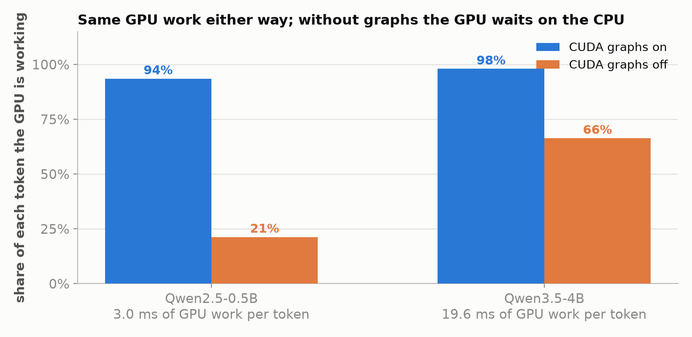

*Part 11 of "The Inference Wall". Back on the series rig: one NVIDIA A10G with 23 GB, vLLM
0.18.0, Qwen3.5-4B in fp16, with two smaller Qwen2.5 models alongside. Draft.*

*Manas Pathak · draft, November 2026*

[The Inference Wall]({{ '/' | relative_url }}) · [All posts]({{ '/articles/' | relative_url }}) · **Part 11**

[Part 10]({{ '/articles/part-10/' | relative_url }}) ended with a small number it did not
explain. On top of the time spent reading a model's weights from memory, every token on the
GPU carried a fixed cost of about a millisecond, and on small models that millisecond was a
large share of each token. This post finds where it comes from. A GPU does not decide what
to run next. The CPU tells it, one small program at a time, and telling it takes time. Most
of that time disappears behind a feature called CUDA graphs, which vLLM turns on by default,
and the millisecond Part 10 measured is the part that remains.

The short answer: with CUDA graphs turned off, the 4B model takes 1.5x as long per token for
one user, and a 0.5B model takes 4.4x as long, because the GPU sits idle waiting for its next
instruction. Under heavy load the 4B's difference shrinks to almost nothing, because the GPU then has
enough work of its own that the waiting stops mattering; the smaller models still lose
ground at 64 requests.

## A short primer: kernels, launches, and graphs

**CUDA** is NVIDIA's platform for running programs on its GPUs. Work on the GPU is split into
**kernels**. A kernel is one function, such as a matrix multiply or a normalization, that the
GPU runs across thousands of threads at once; it does one operation on one set of inputs and
then ends. Running a model on a GPU means running its kernels one after another.

The GPU does not choose which kernel comes next. The CPU does, by **launching** each one: it
fills in the kernel's arguments, such as where its inputs and outputs sit in GPU memory, and
places it in a queue the GPU reads from. A launch is asynchronous, which means the CPU does
not wait for the kernel to finish. It returns right away and can launch the next kernel while
the GPU works through the queue in order, so as long as the CPU keeps the queue ahead of the
GPU, the GPU never waits.

Producing one token means running every layer of the model, and each layer is several
kernels: multiply by the attention weights, compute attention, multiply by the MLP weights,
normalize, and so on. For the 4B model that comes to about 530 kernels per token, and each
one is a launch. The launch call itself typically takes a few microseconds, but a serving
engine also has to work out what to launch and prepare its inputs, and in vLLM much of that
deciding code is Python. If the CPU takes longer to launch a kernel than the GPU takes to run
it, the queue runs dry and the GPU sits idle until the next kernel arrives.

That gives the time per token a different shape from the one in earlier posts:

```
time per token  =  the longer of:   GPU work for the token
                                    CPU time to launch the token's kernels
```

The GPU work is the weight reading and arithmetic the series has measured all along. The
CPU launch time is the number of kernels times the CPU cost of launching each one, and it
barely depends on how many requests share the step, because a batch of 64 requests runs
about the same number of kernels as a single request, each one simply doing more work.

A **CUDA graph** removes most of the second line. Instead of launching kernels one by one,
the server records them. When it starts up, it runs the model's kernels once in a capture
mode, and CUDA stores the whole sequence, every kernel together with its arguments, as one
object. To produce a token, the CPU then replays that recording with a single call, and the
GPU runs most of the 530 kernels back to back with no CPU work between them.

A recording has two limits that matter later. It stores fixed memory addresses, so every
replay must read its inputs from the same places in GPU memory and the server copies each
step's data there first. It also stores fixed sizes, so a graph recorded for a batch of 8
requests can only run a batch of 8. vLLM therefore records a set of graphs at startup, one
per batch size, and pads each step up to the nearest size it recorded.

## What turning graphs off costs

The measurement runs each model twice on the A10G, with CUDA graphs on, the vLLM default,
and with only the graphs turned off. Everything else is held fixed, including the
compilation step that vLLM runs alongside graphs. Each run sends requests with a 128-token
prompt and 256 generated tokens, at 1, 4, 16, and 64 requests in flight at once, and reports the median time per output
token. Three models give three sizes of GPU work per token:
Qwen2.5-0.5B, Qwen2.5-3B, and the series' Qwen3.5-4B.

| Model | Graphs on, 1 request | Graphs off, 1 request | Slowdown | Graphs on, 64 requests | Graphs off, 64 requests |
|---|---|---|---|---|---|
| Qwen2.5-0.5B | 3.3 ms | 14.2 ms | 4.4x | 5.6 ms | 16.8 ms |
| Qwen2.5-3B | 14.9 ms | 28.8 ms | 1.9x | 22.6 ms | 30.8 ms |
| Qwen3.5-4B | 20.0 ms | 29.6 ms | 1.5x | 41.1 ms | 41.1 ms |


The flat lines are the evidence. With graphs off, time per token barely changes between one
request and sixteen, on every model. That is the signature of the CPU setting the pace:
launching 530 kernels takes about as long whether each kernel serves one request or sixteen.
With graphs on, time per token starts far lower and rises with load, because now the GPU's
own work sets the pace, and that work grows with the batch.

The two lines meet where the GPU's work for a token catches up with the CPU's launch time.
On the 4B that happens by 64 requests, where both take 41 ms, and under the series' standard
flood of requests the two modes are level, 1,088 against 1,082 tokens a second. On the 3B the gap narrows from 1.9x to 1.4x by 64 requests. On the 0.5B they never meet in this range, because its GPU
work per token is so small that even 64 requests leave the GPU waiting on the CPU.

## The GPU does the same work either way

A profiler trace records every kernel the GPU ran, with its start time and duration.
Traces of a single request decoding, with graphs on and off, settle what the slowdown is.
The kernels are nearly the same in both, about 290 to 335 per token on the 0.5B and 510 to
530 on the 4B, and the GPU spends the same time running them: 3.0 ms per token on the 0.5B
and 19.6 ms on the 4B, in both modes. Turning off graphs adds no GPU work at all. It adds
idle time between kernels.

Dividing that GPU time by the measured time per token gives the share of each token the
GPU spends working:



With graphs, the GPU is working 94 to 98% of the time. Without them, the 0.5B's GPU works
21% of the time and spends the rest waiting, and the 4B's works 66% of the time. In the
trace the waiting shows up directly: with graphs, the median gap between one kernel ending and the next starting is
a tenth of a microsecond, and without them the slowest tenth of gaps run past 140
microseconds on both models. The profiler itself slows the CPU's launching, so the traces
exaggerate the gaps, and the shares above come from the timings measured without it.

Without graphs the CPU's work for each token, divided by the kernels it launches, comes to
about 50 to 60 microseconds per kernel: 14.2 ms for the 0.5B's 287 kernels and 29.6 ms for
the 4B's 514. That figure folds in the CPU's other per-token work, such as scheduling the
step, alongside the launches themselves.
That cost per kernel is close on both models, so what decides how much a model loses is how
much GPU work it has to hide the launches behind. The 0.5B's 3 ms of GPU work hides almost
none of its 14 ms of launching. The 4B's 20 ms hides about two thirds of its 30.

## Back to Part 10's millisecond

Part 10 measured its A10G fixed cost with llama.cpp, whose CUDA build was compiled with CUDA
graphs enabled, so that millisecond was most likely already the cost left over after graphs. The same holds in vLLM. With
graphs on, a token takes 3.3 ms on the 0.5B and 20.0 ms on the 4B, against 3.0 and 19.6 ms of
GPU work, leaving 0.2 to 0.4 ms of fixed cost per token. With graphs off, the leftover is
about 10 to 11 ms on both. CUDA graphs are what turn roughly ten milliseconds of per-token
overhead into well under one, and the fraction of a millisecond that remains is the replay itself plus the work that
runs outside the recording. The 0.5B's trace shows about 22 kernels per token launched
separately from the graph, alongside the CPU's work of scheduling each step and returning
its token.

## What graphs cost

Recording the graphs takes time at startup and memory on the GPU. Capture took 3 to 6 seconds and about 0.4 to 0.6 GB of GPU memory, depending on the
model. vLLM compiles the model as well, with graphs on or off, and the first, cold compile with
graphs took 17 to 36 seconds and pushed the 4B's first start to about five minutes; with
the compiled result cached, later starts took 25 to 90 seconds.

Because each recording has a fixed batch size, vLLM records graphs for 1, 2, 4, and 8
requests, then every 8 up to 256 and every 16 up to 512. The padding up to the nearest
recorded size is wasted work and likely contributes a little to the shrinking advantage at
larger batches, though the main cause measured here is the GPU's own work catching up.

Turning graphs off is mainly useful for debugging the CPU side of a server, where a replayed
recording collapses hundreds of separate launches into one call. vLLM's `--enforce-eager`
flag does it, but it also turns
off compilation, which on the 4B made things worse still: 36.8 ms per token against 29.6 ms
with compilation kept on. The more targeted setting turns off graphs alone.

## What to take away

1. **The CPU decides what the GPU runs, and telling it takes time.** Each token is hundreds
   of kernel launches, and without graphs vLLM's CPU work comes to about 50 to 60
   microseconds per kernel.
2. **Without CUDA graphs, time per token is the longer of the GPU's work and the CPU's
   launching.** For small models and light load the launching wins: one request on the 0.5B
   ran 4.4x slower, on the 4B 1.5x slower.
3. **The GPU's work does not change; only its waiting does.** The same kernels took the same
   GPU time in both modes, and the GPU's working share fell from 94 to 98% to 21 to 66%.
4. **Load hides the launching.** As batches grow, the GPU's work per token catches up with the
   CPU's fixed launch time, and on the 4B under heavy load the two modes are level.
5. **Part 10's millisecond is what graphs leave behind.** With graphs, 0.2 to 0.4 ms per token
   remains in vLLM; without them, about ten.

---

*Reproduce: all runs used vLLM 0.18.0 on one A10G with `--dtype float16 --max-model-len 2048
--max-num-seqs 256 --gpu-memory-utilization 0.9`. "Graphs off" is
`--compilation-config '{"cudagraph_mode":"NONE"}'`, which keeps compilation on; the eager
comparison is `--enforce-eager`. Speed is `vllm bench serve` on random 128-token prompts with
256 output tokens, a warm-up pass discarded, at `--max-concurrency` 1, 4, 16, and 64; the 4B
also ran the series' standard flood of 200 requests at 256 in and 128 out. Traces are a
one-second torch profiler window during a single long decode, captured on separate server
runs so the profiler could not affect the speed numbers. GPU work per token comes from the
traces and time per token from the unprofiled runs. The drivers, trace capture, and analyzers
are in
[`experiments/11-cuda-graphs/`](https://github.com/mapathak-commits/inference-wall/tree/main/experiments/11-cuda-graphs);
the benchmark logs, server logs with the capture timings, and the six traces are in
[`benchmarks/11-cuda-graphs/`](https://github.com/mapathak-commits/inference-wall/tree/main/benchmarks/11-cuda-graphs).*

---

**Previous:** [Part 10: Off the rig, part two]({{ '/articles/part-10/' | relative_url }}) · [All posts]({{ '/articles/' | relative_url }})

---

*Disclaimer: This blog is written and published in my personal capacity. The opinions,
findings, and conclusions expressed herein are solely my own and do not necessarily
represent the views, policies, or endorsements of my current or past employers.*
