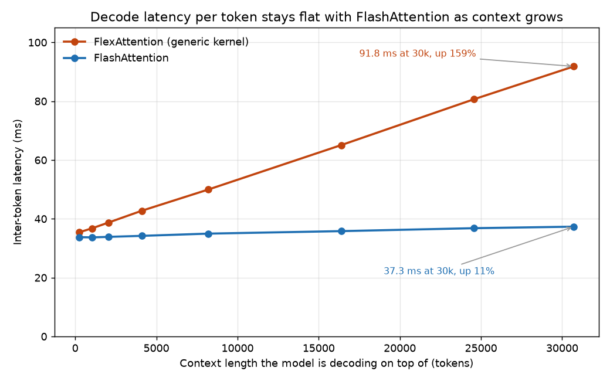
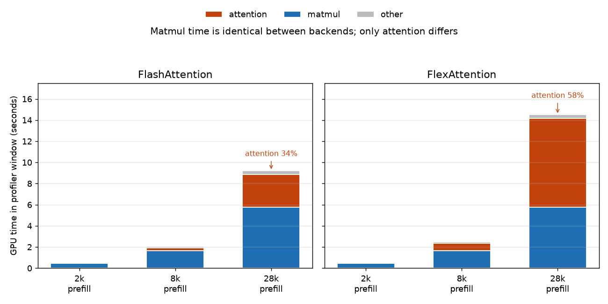

*Part 8 of "The Inference Wall". Same GPU as the rest of the series, one NVIDIA A10G with
23 GB, but a different model and an earlier engine: Qwen2.5-7B-Instruct, bf16, single
stream, vLLM 0.11.0. Draft.*

*Manas Pathak · draft, September 2026*

[The Inference Wall]({{ '/' | relative_url }}) · [All posts]({{ '/articles/' | relative_url }}) · **Part 8**

FlashAttention is the attention kernel underneath most modern serving stacks. It computes
the same attention every transformer does, but without ever writing the large intermediate
score matrix out to GPU memory, which is where a naive implementation spends most of its
time. This post measures what that buys, and the answer turns out to depend almost
entirely on how long the prompt is.

The study is a single-variable sweep over prompt length, from 256 tokens up to 30,720,
with the model, the GPU, and the single-stream probe held fixed. It runs once with
FlashAttention and once with a general-purpose attention kernel that lacks
FlashAttention's memory tuning, so the difference between the two runs is attention and
nothing else, and a profiler trace then confirms kernel by kernel that the wall-clock gap
sits where the arithmetic says it should.

Two departures from the series rig need stating. The model is Qwen2.5-7B-Instruct rather
than Qwen3.5-4B, because Qwen3.5 is hybrid: 24 of its 32 layers never run the attention
kernel, as [Part 7]({{ '/articles/part-7/' | relative_url }}) showed, so comparing
attention kernels on it would measure a quarter of the model. A dense model makes
attention the whole story. The engine is also older than the rest of the series, since
this study was run on vLLM 0.11.0 before the move to 0.18.0.

The payoff grows with the prompt rather than sitting at a fixed percentage. At 256 tokens
the two kernels finish within three milliseconds of each other, and at 30,720 they are six
seconds apart on the same hardware, because FlashAttention optimizes attention and
attention cost grows with the square of prompt length. The gain is negligible at the short
prompts most benchmarks use and large at the long contexts production hits. One fact from
the [primer]({{ '/articles/primer/' | relative_url }}) carries the rest: serving a token
has two phases, a **prefill** that reads the whole prompt in one dense pass and a
**decode** that emits the answer one token at a time. Attention behaves differently in
each, and FlashAttention changes both.

## Why attention grows faster than everything else

A transformer layer does two large things per token: a stack of matrix multiplies for the
projections and the MLP, and an attention step. The matmuls are the model's fixed cost,
sized by the model's width rather than the prompt, so their total grows **linearly** with
prompt length. Attention grows faster, because every token attends to every token before
it, which over a prompt of length *N* means *N* positions each scoring up to *N* others,
or *N* squared. Double the prompt and the matmuls double while the attention quadruples,
which is why attention starts negligible and, past some crossover, takes over.

The crossover is visible in FlashAttention's own prefill time, fit to a curve with the
quadratic piece pulled out as a share of the total:

| Prompt length | Prefill time | Share that is the quadratic attention term |
|---|---|---|
| 2,048 | 0.50 s | 3.4% |
| 8,192 | 2.07 s | 12.2% |
| 32,768 | extrapolated | 35.8% |

At 2,000 tokens the quadratic term is 3%, lost in the linear matmul cost. That is the
region a casual benchmark lives in, and why attention optimizations look pointless there.
By 32,000 tokens it is more than a third of the prefill and climbing. Optimizing attention
matters once attention is a large enough slice of the bill, and that depends on prompt
length.

## What FlashAttention does

Although the name suggests speed, the mechanism is about memory. The naive way to compute
attention is to build the full table of scores: for a prompt of length *N*, an *N* by *N*
grid where entry *i*, *j* is how much token *i* attends to token *j*. At 30,000 tokens that
grid is 900 million numbers **per attention head**, across many heads and many layers.
Writing it out to the GPU's main memory, the HBM, and reading it back for the softmax is a
large amount of memory traffic, and on modern GPUs memory traffic is the binding
constraint long before arithmetic is.

FlashAttention, from [Dao et al. 2022](https://arxiv.org/abs/2205.14135), never holds the
whole grid at once. It walks the prompt in tiles that fit in the GPU's small on-chip SRAM,
which is far faster than HBM, computes each tile's scores there, folds them into a running
softmax, and discards them before the next tile. The *N* by *N* grid is never written to
main memory, so the arithmetic stays the same while the memory traffic drops from
quadratic to linear. That is why the kernel is called IO-aware: it is optimized around the
memory system.

Decode gets a second, related trick, because its shape is different. To emit token 30,001
the model attends back over all 30,000 cached tokens but produces only one new token, so
there is little arithmetic to hide the cost of that long read. The decode-side form, sometimes called FlashDecoding,
splits the read across many parallel workers on the GPU and combines their partial
results, so the whole chip does the read at once. The trace below shows this split is
where the decode gap comes from.

One note on the comparison, because it shapes what the gaps mean. Since FlashAttention is
the default and there is no switch that turns it off, measuring it means swapping in a
different backend, and the counterfactual here is **FlexAttention**, PyTorch's
general-purpose compiled kernel. FlexAttention is a real tiled compiled kernel rather than
a naive materialize-the-grid implementation; what it lacks is FlashAttention's memory
tuning and its split-the-read decode. The numbers below are therefore what
FlashAttention's specialization buys over a competent generalist, a harder bar than a
strawman. The backend is selected by one environment variable at server start and
everything else is held fixed.

## Prefill: the quadratic term gets steeper

The probe sends one prompt at a time, warm, and records time-to-first-token, which is
essentially prefill time, as prompt length climbs from 256 to 30,720 tokens:

At 256 tokens the two are three milliseconds apart, by 8k the gap is half a second, by 16k
nearly two seconds, and by 30k it is **6.2 seconds**. Fitting each curve to a quadratic
makes the mechanism explicit. Both fits share the same linear coefficient, about 220
microseconds per token, which is the matmul cost common to both, and they differ only in
the quadratic coefficient, the pure-attention part: **3,689 picoseconds per token-squared
for FlashAttention against 10,099 for FlexAttention**, 2.7 times steeper. Because that
coefficient multiplies *N* squared, it is invisible at small *N* and dominant at large
*N*.

## Decode: a flat line hides the gap

Decode is where the split-the-read trick pays, and the numbers are more lopsided. The probe
also measures **inter-token latency**, the gap between successive output tokens, as a
function of how much context the model is decoding on top of:

FlashAttention's decode stays close to flat, rising from 33.8 ms at short context to
37.3 ms at 30k, an 11% increase across a 120-fold increase in context. FlexAttention starts
at the same place and climbs to 91.8 ms, a 159% rise, nearly tripling per-token latency
because the context got longer. FlashAttention's decode kernel spreads the long cached-context read across the
whole GPU, so it costs about the same wall-clock time however long the context is.
FlexAttention's read does not parallelize that way, so every extra thousand tokens of
history adds directly to every token's latency. A decode benchmark at 2,000 tokens, the
length most quick tests use, would show 33.9 against 38.7 ms and hide the divergence.

## The trace: the gap is one kernel family

The client-side numbers point at attention, and a profiler trace can confirm it directly.
Both backends were re-run with vLLM's torch profiler armed, a bounded window was captured
at three prefill lengths and two decode depths, and every GPU kernel was bucketed into
three families: **attention**, **matmul** for the projections and MLP, and everything
else. The traces open in a browser with no GPU, as the reproduce section describes.

A trace is a timeline of every kernel the GPU ran, each with a name and a duration, so
adding up the durations by family says where the seconds went. The figure below does that
for the three prefill windows: each bar is the total GPU time in one window, split into
how much went to matmuls, to attention, and to everything else.

The blue matmul segments are the control. They are identical between the two backends to
within a millisecond at every length, 5,756 against 5,755 ms at 28k, because it is the
same model doing the same projections and MLP, so every difference between the bars is in
the attention segment. At 2k that segment is small for both, 22 ms against 52. At 28k
FlashAttention computes attention in 3.1 seconds and FlexAttention needs 8.4 for the same
math, a **2.7-fold** gap, and since the matmuls matched, that 5.3-second attention gap is,
within rounding, the entire gap between the two bars, 9.2 seconds against 14.5. On
FlexAttention, attention has grown to 58% of all GPU time and is the single largest thing
the GPU does, which is the quadratic term seen directly.

The decode trace puts names on the two kernels. FlashAttention's is
`flash_fwd_splitkv_kernel`, "split the KV read", the split-the-read trick by name, and it
is the same tiled kernel used in prefill, so decode attention stays around 31% of the
window at 28k and per-token latency stays flat. FlexAttention runs a single compiled kernel, `triton_tem_fused_0`, with no
split; at 28k it takes **58% of the window**, and the window is 17.0 seconds against
FlashAttention's 10.3. That is the 11%-versus-159% decode gap at the kernel level: one
kernel that parallelizes the long read against one that does not.

## What to take away

1. **The benefit scales with prompt length.** FlashAttention was three milliseconds ahead
   at 256 tokens and six seconds ahead at 30,000, on the same model and GPU, because it
   optimizes attention and attention cost grows with the square of prompt length. Judge it
   by the context length you actually serve rather than by a short-prompt benchmark.

2. **What it cuts is memory traffic.** It computes attention in on-chip tiles and
   never writes the full score grid to main memory, turning quadratic memory traffic into
   linear, and for decode it splits the long cached-context read across the whole GPU,
   which is why its per-token latency stays flat as context grows while the generic
   kernel's climbs 159%.

3. **The trace turns the claim into a measurement.** Matmul time was identical between the
   two backends to within a millisecond, so every second of difference lived in attention,
   and the decode gap resolved to one named kernel, `flash_fwd_splitkv`, against a compiled
   kernel that does not split the read. Since FlexAttention is a real compiled kernel
   rather than a strawman, these are the gains over a competent generalist.

The next post takes the model off the rig entirely and decodes it on two CPUs, a server
and a laptop, where memory bandwidth rather than the GPU decides the result.

---

*Reproduce: the prefill and decode probe `s1_probe.py`, the trace-capture driver
`s3_capture.py`, the kernel-family census `tp_census.py`, and the server launch script are
in
[`experiments/08-flash-attention/`](https://github.com/mapathak-commits/inference-wall/tree/main/experiments/08-flash-attention);
the raw probe logs, the fitted coefficients, and the profiler traces, gzipped chrome-trace
JSON openable in `chrome://tracing` or [ui.perfetto.dev](https://ui.perfetto.dev) with no
GPU, are in
[`benchmarks/08-flash-attention/`](https://github.com/mapathak-commits/inference-wall/tree/main/benchmarks/08-flash-attention).
Single A10G, Qwen2.5-7B-Instruct, bf16, single stream, vLLM 0.11.0; the absolute numbers
are rig-specific. The backend is selected at server start with the
`VLLM_ATTENTION_BACKEND` environment variable, `FLASH_ATTN` against `FLEX_ATTENTION`;
everything else is held fixed.*

---

**Previous:** [Part 7: Speculative decoding]({{ '/articles/part-7/' | relative_url }}) · **Next:** Part 9, coming next Friday · [All posts]({{ '/articles/' | relative_url }})

---

*Disclaimer: This blog is written and published in my personal capacity. The opinions,
findings, and conclusions expressed herein are solely my own and do not necessarily
represent the views, policies, or endorsements of my current or past employers.*
