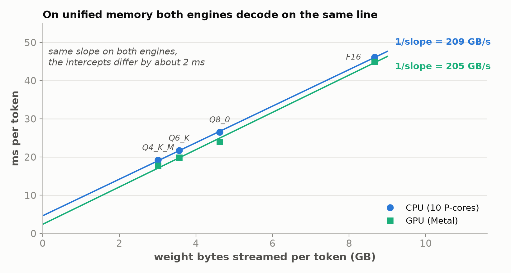
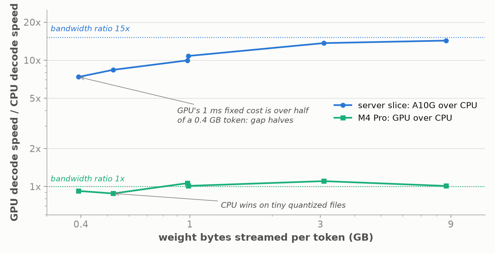
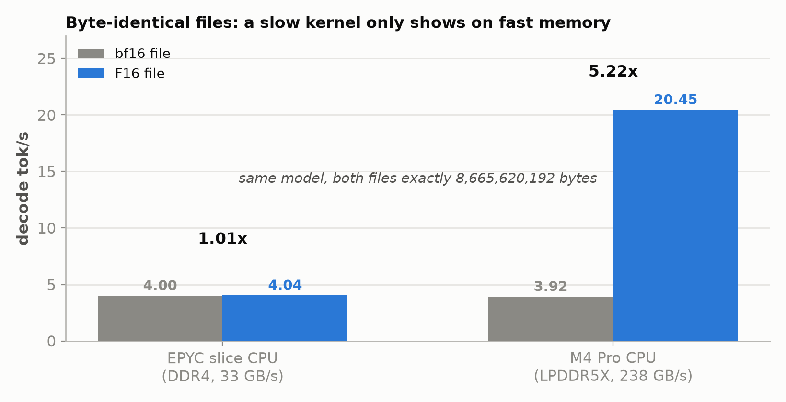
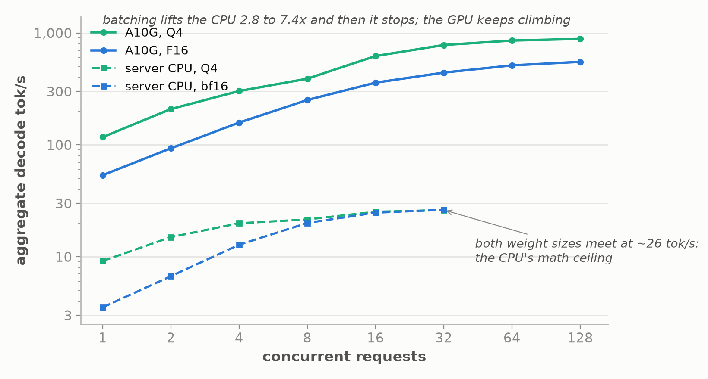

*Part 9 of "The Inference Wall", run off the series' usual rig: Qwen3.5-4B on two very
different CPUs, a cloud server slice and a laptop, with each machine's own GPU alongside
for comparison. Draft.*

*Manas Pathak · draft, October 2026*

[The Inference Wall]({{ '/' | relative_url }}) · [All posts]({{ '/articles/' | relative_url }}) · **Part 9**

When I started learning about LLMs, I took it as given that inference meant a GPU, and
that a CPU was where you ran a model only if you had no choice. That assumption deserves a
test. CPUs are everywhere: every laptop, every phone, every server already has one, often
sitting idle, and none of them is thought of as an AI platform. If the claim this series
is built on is right, that decode is limited by how fast memory can be read rather than by
how fast the chip can do math, then whether a CPU can run a model well turns on its memory
system, not on its being a CPU. This post takes the same model and the same engine to two
CPUs with very different memory, a cloud server slice and a laptop, each with its own GPU
alongside, and works out where a CPU is fine and where it is not.

The short answer: it depends on the memory, not the chip. On a laptop with fast memory,
the CPU runs the model within about 2.5x of a datacenter GPU for one user. On a cloud
server slice with slow memory, the CPU is 13x behind. Where a CPU falls down is serving
many users at once.

The claim under test is the one from the [primer]({{ '/articles/primer/' | relative_url }})
and [Part 1]({{ '/articles/part-1/' | relative_url }}): to produce each token, the
machine reads the entire model's weights from memory once. Written as the time one token
takes, the claim is a line with two terms:

```
time per token  =  weight bytes / memory bandwidth  +  fixed cost per token
```

The first term is the streaming. It is set by how many bytes the model is and how fast
the memory bus moves them, and it has nothing to do with how fast the chip does math,
because at one request each weight is read once, used for one multiply-add, and
discarded; the arithmetic is finished long before the next byte arrives. The second term
is everything that does not scale with bytes: launching the work for each of the model's
layers, synchronizing threads, bookkeeping between tokens. On a big model and a slow bus
the first term is nearly the whole token and the second is a rounding error. Every result
below is one of three things happening to that line: the first term dominating, so the
gap between two chips is the gap between their memory buses; a kernel too slow to keep up
with its bus, so the machine falls off the line entirely; or batching, which shares the
first term across many tokens until the math, finally, is what binds.

Three qualifiers apply throughout. This is
one request at a time; [Part 3]({{ '/articles/part-3/' | relative_url }}) showed what
batching does to it, and the last section measures that on a CPU. Every weight is read
for every token, which would not hold for a mixture-of-experts model. And the contexts
are short, so the per-token read of the conversation so far is small next to the
weights.

## Two machines, chosen for their memory

The two CPUs were picked to be as far apart as possible on one axis, memory bandwidth,
and each sits next to a GPU so the CPU-to-GPU gap can be measured on the same box.

- **A cloud server slice.** An AWS g5.4xlarge: 8 physical cores and 16 threads of an AMD
  EPYC 7R32, 62 GiB of DDR4, one NUMA node, and the series' NVIDIA A10G. Its measured
  streaming bandwidth is **33 GB/s**, saturating at two threads. That is a slice of the
  socket's memory system, not the socket; a full EPYC with eight channels delivers roughly
  200 GB/s. The CPU and the GPU sit on separate memory pools with a large cliff between
  them: the A10G's nominal bandwidth is 600 GB/s.
- **A laptop.** An Apple M4 Pro with 10 performance and 4 efficiency cores, 48 GB of
  LPDDR5X, and a 20-core GPU. Measured streaming bandwidth is **238 GB/s**, against a
  nominal 273, about seven times the server slice. Its CPU and GPU share the same
  physical memory and the same bandwidth. There is no cliff, by construction.

So the server slice has a CPU with laptop-class memory and a GPU with datacenter memory,
and the laptop has a CPU and a GPU with identical memory. If decode is bandwidth-bound,
the CPU-to-GPU gap should be large on the first machine and close to 1x on the second,
and the laptop's CPU should beat the server's CPU by about the bandwidth ratio.

The engine is [llama.cpp](https://github.com/ggml-org/llama.cpp), because it is the one
engine that runs the identical code on a CPU, on an Apple GPU through Metal, and on an
NVIDIA GPU through CUDA. The series' own engine was ruled out first: vLLM's CPU backend
has no kernel for Qwen3.5's linear-attention layers, so the same server cannot be pointed
at a CPU at all, a finding in its own right. Two llama.cpp builds were used, 458681e on
the server and dfc29b6 on the laptop, a day apart at the start of September 2026. The model is Qwen3.5-4B in
GGUF form at several weight sizes, from 3.0 GB at 4-bit to 8.7 GB at 16-bit. Prefill and
decode throughput are measured separately by `llama-bench`, in tokens per second.

## The decode gap follows memory bandwidth

Each machine offers two competing predictions for how much faster its GPU should decode
than its CPU: the ratio of their memory bandwidths, or the ratio of their math rates.
The two predictions differ enough to tell apart.

| | Server slice + A10G | M4 Pro CPU + GPU |
|---|---|---|
| Bandwidth ratio predicts | 600 / 33 = **18x** | 238 / 238 = **1.0x** |
| Compute ratio predicts | **43x** | **2.7x** |
| Measured decode gap, same engine, same weights | **13.5x** at F16, 12.2x at Q4 | **1.09x** |


On the server slice, bandwidth predicts 18x and the measurement is 13.5x, with the GPU
reaching about 79% of its nominal bandwidth in decode, which is in line with
[Part 1]({{ '/articles/part-1/' | relative_url }}). Compute predicts 43x, and that is
the generous reading: 43x compares the A10G's non-tensor rate of 31.2 TFLOP/s to the
CPU's 0.72; with tensor cores the A10G's dense fp16 rate is 125 TFLOP/s and the compute
prediction becomes 174x. Either way compute is off by a factor of three or more and
bandwidth is the right frame.

On the laptop the two engines share one memory bus, so bandwidth predicts no gap at all.
Measured carefully, with the CPU and GPU runs interleaved so each pair shares a thermal
state, the GPU decodes **1.089x** faster, the median of twelve paired runs ranging from
0.969x to 1.277x. In one round the CPU won. Compute predicts 2.7x. Two engines whose
math rates differ by 2.7x decode at the same speed when they share a memory bus, which
is only possible if decode never depended on the math.

Prefill is the control. It is compute-bound, so the GPU should keep its advantage on the
laptop even though the memory is shared, and it does: Metal prefill is 2.9 to 3.5x the
CPU's across the weight sizes, against the 2.7x compute ratio. Same machine, same memory,
one phase closes to 1x and the other stays at 3x. That is the compute-versus-bandwidth
split in one pair of columns.

In the equation's terms, both machines are in the regime where the first term is nearly
the whole token, so the ratio of two chips' decode speeds is the ratio of their memory
bandwidths and nothing else. The server tests that with a large prediction, 18x, which is
hard to fake. The laptop tests it with a null prediction, 1x, which many wrong models
would also make, so the laptop's real evidence is the next section.

## Decode time is a straight line in bytes

The equation says time per token is a straight line in model size, with a steepness set
by the memory bandwidth and an intercept equal to the fixed cost. That can be fitted
directly. Four weight sizes on the M4 Pro, Q4_K_M at 3.0 GB, Q6_K at 3.6 GB, Q8_0 at
4.6 GB, and F16 at 8.7 GB, run on both engines and fit to the two-term line:



The slope of each line is one over the bandwidth, and reading the bandwidth off gives
**209 GB/s for the CPU and 205 GB/s for the GPU**, 88% and 86% of the measured 238 GB/s
ceiling. The study's audit refit the lines against every choice of which measurement
round supplied each point, 81 combinations, and the median bandwidth stayed within 1% of
these figures on both engines. Two engines with 2.7x different math rates decode on the same line, and that line's
steepness is the machine's memory bandwidth. The fit's intercepts, 2.4 ms for the GPU
and about 4.6 ms for the CPU, looked at first like a difference in fixed cost. They are
not. The follow-up with smaller models below, which holds the weight format fixed, puts
the fixed cost near 1 ms on both engines. What the ladder fit was absorbing into its
intercept is a third thing the one-line equation leaves out: a per-format compute cost.
Four-bit and eight-bit weights must be unpacked before use, and that costs more
instructions per byte than F16, so the quantized points sit a little above the line that
the F16 points define. On the ladder, format changed together with size, so the format
cost looked like a constant.

That is also why the simple one-line claim starts to leak on fast memory. On the server
slice, streaming 3 GB of Q4 weights takes about 91 ms, so a few milliseconds of fixed and
format cost are a rounding error and effective bandwidth comes out constant across weight
sizes: 34, 32, and 30 GB/s for bf16, Q8, and Q4, all at the 33 GB/s wall. On the laptop,
streaming the same 3 GB takes about 14 ms, the fixed and format costs did not shrink with
it, and effective bandwidth is no longer constant, rising from 157 GB/s at Q4 to 188 GB/s
at F16 on the CPU within the same session. The faster the memory, the larger the share of
a token everything other than streaming takes, and the sooner it becomes the thing worth
optimizing. The constant-effective-bandwidth check is a slow-machine diagnostic; once
memory is fast, the line with an intercept is the right model, and the intercept has to
be measured with the format held fixed.

## Does model size change the gap?

In the equation, model size cancels out of the ratio between two chips as long as the
first term dominates, so the gap should not depend on size until the fixed cost does.
Three smaller models, Qwen2.5 at 0.5B and 1.5B in several formats, were run on both
machines with the same engine and a same-session 4B anchor. Because these files store an
output head separate from the embedding table, the table is read one row per token rather
than streamed, so the bytes that matter are the file minus the table, 14 to 29% less. The
4B stores them tied, so its file bytes are honest. Fitting the line on streamed bytes with
the format held fixed gives each chip's two terms:

| | Memory bandwidth, from the fit | Fixed cost per token |
|---|---|---|
| Server slice CPU | 33 GB/s | 3.1 ms |
| A10G | 503 GB/s | 1.1 ms |
| M4 Pro CPU | 209 to 222 GB/s | 0.9 to 1.2 ms |
| M4 Pro GPU | 208 to 232 GB/s | 0.8 to 1.2 ms |

The fixed cost is about a millisecond on three of the four chips and three on the server
CPU, where eight threads synchronize over a slow bus. The gap at each size follows:

| Model | Streamed GB | Server GPU / CPU | M4 Pro GPU / CPU, two sessions |
|---|---|---|---|
| 0.5B Q4 | 0.39 | 7.4x | 0.90x, 0.95x |
| 0.5B Q8 | 0.53 | 8.4x | 0.86x, 0.90x |
| 1.5B Q4 | 0.98 | 10.0x | 1.07x, 1.06x |
| 0.5B F16 | 0.99 | 10.8x | 1.03x, 0.99x |
| 1.5B F16 | 3.09 | 13.7x | 1.10x, 1.11x |
| 4B F16 | 8.66 | 14.3x | 0.99x, 1.04x |



On the server the gap halves as the model shrinks, from 14.3x to 7.4x, even though the
CPU's fixed cost is the larger one in milliseconds. The equation says why: what matters is
each chip's fixed cost as a share of its own streaming time. At 0.4 GB the A10G streams
the weights in under a millisecond and then spends a millisecond on fixed work, so its
token is more than half overhead, while the CPU's 3 ms is a fifth of its 12 ms stream. As
the model shrinks further the gap tends toward the ratio of the two fixed costs, about
3x, and the GPU's bandwidth advantage stops counting. On the M4 Pro the two fixed costs
are equal, so the gap stays near 1x at every size for F16, and the two engines tie at the
4B anchor, 0.99x and 1.04x across sessions. The small quantized files are the one
departure: there the CPU wins, 0.86 to 0.95x, because Metal's four-bit and eight-bit
kernels fall further below their own line at a hidden size of 896 than the CPU's do. The
likely reason is that the work is too small to fill the GPU, but that was not measured.

So the answer is that model size changes the gap only through the second term, and on
both machines the second term favors the CPU at small sizes. The 13.5x and 1.09x of the
earlier sections are the large-model numbers, where the first term is nearly the whole
token.

## Two byte-identical files

The cleanest measurement in the study. The model was saved in two 16-bit formats, bf16
and F16. The two files are the same size to the byte, 8,665,620,192 bytes, so the number
of bytes read per token is identical. The formats are not the same information, bf16
spends more bits on exponent and F16 on mantissa, but for a bandwidth argument only the
byte count matters: if decode is "read all the bytes," both files must decode at the same
speed on the same machine.

| machine | bf16 decode | F16 decode | F16 / bf16 |
|---|---|---|---|
| Server slice CPU | 4.02, 3.99 tok/s | 4.04, 4.03 tok/s | **1.005x, 1.010x** |
| M4 Pro CPU | 3.92 tok/s | 20.45 tok/s | **5.22x** |



On the server they do. On the laptop they do not, by 5.22x against about 1.01x on the server, with the
hardware and the byte count held constant. The reason is software: llama.cpp has a fast NEON kernel for
F16 and only a slow generic path for bf16 on this CPU. On the laptop, decode from the bf16 file is bottlenecked on that slow kernel long before
it reaches the memory wall, at about 34 GB/s effective on a 238 GB/s machine. This is the
one case the equation does not cover: the bytes arrive faster than the kernel can consume
them, so the machine has fallen off the line and is limited by instruction throughput,
not memory. Compute matters here only as a threshold. A chip needs enough of it per byte
to keep up with its own bus, and once it has that, more buys nothing. Swap to the F16
file and the same bytes flow through a fast kernel, and decode jumps to 20 tok/s, 177
GB/s effective, back on the line at the memory wall.

Now look at the server row again. The same slow bf16 kernel runs there, and it costs
nothing, because the memory is slower than the kernel. Streaming 8.7 GB at 33 GB/s caps
decode at about 4 tok/s whatever the kernel does, so fixing the kernel buys nothing. The
bf16 row on the server also runs at 34 GB/s effective, and it reads as a clean
confirmation that decode is at the memory wall. It is. But a slow machine cannot tell the
difference between "at the memory wall" and "held back by a kernel that happens to run at
the same speed as the memory wall." The two explanations only separate on the fast
machine, and the F16 control is what separated them. The first version of the server
study cited that bf16 row as one of its three proofs. It was a right conclusion that
could not be checked until the control was run on both machines. When a measurement
lands exactly on a hardware ceiling, that agreement is evidence only if the ceiling is
high enough that a coincidence is unlikely, which makes fast hardware a better measuring
instrument as well as faster hardware.

## The headline that says a laptop beats a GPU

You may have seen the claim that an Apple laptop matches or beats a datacenter GPU at
LLM inference. The tables above show where it comes from. The M4 Pro CPU decodes Q4
weights at about 52 tok/s, the median of the interleaved runs. The A10G decodes F16
weights at 55. Side by side, the laptop CPU "matches" the GPU.

Those are different weight sizes. Q4 streams a quarter of the bytes per token that F16
does, so the comparison handed the laptop a model that reads a quarter of the bytes and
the GPU one that reads four times as many. Hold the format fixed and the picture is
plain: at Q4 the A10G does 121 tok/s to the laptop's 52, 2.3x ahead; at F16 it does 55
to 20, 2.7x ahead. The GPU wins at every format because it has more memory bandwidth and
decode is bandwidth-bound.

The result worth keeping is the one underneath: a laptop CPU gets within 2.5x of a
datacenter GPU on single-user decode at all, which no CPU could do a generation ago. That
closeness is the LPDDR5X memory. The M4 Pro CPU pulls 177 GB/s of effective decode
bandwidth against 34 on the server slice, and the 5x gap between the two CPUs is the
memory gap, short of the full 7x by the fixed per-token cost from the section above.

## What unified memory changes: energy, and a rule that flips

On the laptop the GPU is 1.09x faster at decode than the CPU across the 4B ladder, and
at F16 the two tie. That invites the conclusion that the GPU is pointless for decode on
a unified-memory machine. It is wrong at the 4B size, for a reason no throughput table
shows, and the reason weakens as the model shrinks.

Measured with Apple's `powermetrics` while decoding, the CPU run draws about 42 W above
idle and the GPU run about 26 W, of which 21.5 W is the GPU itself and the rest the CPU
feeding it. For nearly the same tokens per second, the GPU does the work for **about
1.75x less energy per token**, 1.78x and 1.73x in two independent captures. The CPU run
pins all ten performance cores at 100% against the chip's power ceiling; the same work on
the GPU leaves the CPU at a fraction of that power. At 0.5B Q4 the advantage shrinks to 1.18x, 112 against 132 mJ per token, because at 300
tokens a second the CPU spends 13.6 W just encoding and submitting the GPU's commands. So
the engine choice on this machine has no bandwidth-based answer and a power-based one
that depends on size: for a 4B model, decode belongs on the GPU for battery and heat; for
a tiny one, it barely matters where it runs.

One more unified-memory result, because it flips a discrete-GPU habit. On a normal GPU
box you offload as many layers to the GPU as its memory holds. On the M4 Pro, moving
layers from the CPU to the GPU a few at a time made decode slower across most of the
range: any split from 4 to 16 of the 32 layers ran at 0.80 to 0.87x of all-CPU,
break-even came at about 20 layers, and from 24 layers up
it was faster, reaching 1.19x at full offload.
No bytes cross a bus here, so the cost sits in the handoff between two engines sharing
one memory, measured at about 7 ms per token and not yet explained. The rule on unified
memory is to pick one engine and commit; partial offload exists to cope with limited GPU
memory, and this machine has no such limit.

## Many users at once

Everything above is one request at a time, and that is where a CPU looks best. Batching
is the GPU's real headline in this series: Part 3 showed one weight read serving over a
hundred sequences, lifting the A10G from 49 to 1,091 tok/s, a 22x gain. A CPU can batch
too. The question is how far.

Batching changes the equation. With B requests in flight, one weight read serves B
tokens, so the streaming term is shared and a third term, the math, appears:

```
time per token  =  weight bytes / (B x bandwidth)  +  math per token / compute rate  +  fixed cost
```

At B equal to one the math term is negligible on any chip, which is why compute never
mattered above. As B grows the streaming term shrinks and the math term does not, and at
some B they cross: decode stops being memory-bound and becomes compute-bound. Where the
crossover sits is set by the chip's math rate divided by its memory rate, in operations
per byte read. Single-stream decode needs about one operation per byte, and whatever the
chip has beyond that is batching headroom. The A10G has about 50. The M4 Pro CPU has
about 13. The server slice has about 20 at its measured 0.65 TFLOP/s of matrix math. So
batching should help the server CPU by up to an order of magnitude and then stop, because
its math ceiling is 43x below the GPU's. The slice's own prefill number already
shows the amortization: a 512-token prompt shares one weight read, and bf16 prefill runs
at 40 tok/s against 3.9 for decode, a 10x lift.

Measured with the same tool on both machines, `llama-batched-bench`, with a 128-token
prompt and 128 generated tokens per sequence, aggregate decode tokens per second as the
number of concurrent sequences grows:

| Concurrent sequences | 1 | 2 | 4 | 8 | 16 | 32 | 64 | 128 |
|---|---|---|---|---|---|---|---|---|
| Server slice CPU, bf16 | 3.5 | 6.7 | 12.8 | 20.1 | 24.8 | 26.3 | | |
| Server slice CPU, Q4 | 9.2 | 15.0 | 19.9 | 21.6 | 25.2 | 26.1 | | |
| A10G, F16 | 54 | 93 | 158 | 252 | 360 | 443 | 514 | 552 |
| A10G, Q4 | 117 | 209 | 303 | 390 | 622 | 781 | 856 | 885 |



Batching lifts the CPU 7.4x and then stops. The detail that shows why is that bf16 and
Q4, 2.6x apart at one sequence, have converged on the same 26 tok/s by 32. Once the
weight read is shared across the batch, bytes per token stop mattering and the math rate
binds, so the one lever that moved single-stream decode, quantization, stops moving it.
That is the compute ceiling the roofline predicted, reached at about a third of the
slice's measured matrix-multiply peak. The GPU lifts 8x over the same range and keeps climbing to 552
tok/s at 128 sequences, with Q4 still well ahead of F16 because its bandwidth has not run
out. At one sequence the same-engine gap is 15x. At 32 it is 17x. Where the CPU has
stopped and the GPU has not, it is 21x at F16 and 34x at Q4, and still opening.

So the answer to where a CPU is fine has two halves. For a single user on a machine with
fast memory, a CPU decodes within a factor of two or three of a mid-range GPU, and the
gap is the bandwidth gap. For many users, the gap reopens to the compute gap, because
once reads are shared it is math that binds, and that is the one place the GPU is far
ahead. Decode on a CPU is viable. Serving a crowd from one is not.

## What to take away

1. **One line explains the dynamics: time per token is weight bytes over memory
   bandwidth, plus a fixed cost.** At one request the arithmetic never enters. Compute
   matters only as a threshold a kernel must clear to keep up with its bus, and as the
   term that takes over once batching shares the weight read.
2. **The CPU-to-GPU decode gap is the memory bandwidth gap.** 18x predicted and 13.5x
   measured on a box with a bandwidth cliff; 1.0x predicted and 1.09x measured on a box
   without one. Compute predicts 43x and 2.7x and is wrong on both.
3. **Decode time is a straight line in weight bytes whose steepness is the bandwidth.** On
   the M4 Pro the CPU and GPU lines read 209 and 205 GB/s against a 238 GB/s ceiling. With
   the format held fixed, the fixed cost per token is about a millisecond on the A10G and
   on both M4 Pro engines, and three on the server CPU. Quantized formats add a compute
   cost per byte that only shows on fast memory.
4. **Model size moves the gap only through the fixed cost, and toward the CPU.** On the
   server the gap halves from 14x to 7x between 8.7 GB and 0.4 GB because the GPU's
   millisecond is more than half of its tiny token. On the M4 Pro the engines tie at every
   size for F16 and the CPU wins on the smallest quantized files.
5. **A low ceiling can confirm a wrong explanation.** Two byte-identical files decode about
   1.01x apart on the slow machine and 5.22x apart on the fast one. Only the fast one
   could show that a kernel, not memory, set the speed.
6. **"Laptop beats GPU" compares different weight sizes.** At matched format the A10G
   leads the M4 Pro CPU by 2.3 to 2.7x. The remarkable part is that a CPU is that close
   at all, and the reason is LPDDR5X.
7. **On unified memory, throughput does not decide the engine; power does, and less so
   for small models.** At 4B the GPU is 1.09x faster and 1.75x more energy-efficient at
   decode; at 0.5B the energy edge is 1.18x. Partial offload is slower than either engine
   alone.
8. **A CPU is fine for one user with fast memory, and not for a crowd.** Batching lifts
   the server CPU 7.4x and then hits its math ceiling at 26 tok/s, where bf16 and Q4
   converge; the GPU is at 552 and still climbing.

---

*Reproduce: both machines ran `llama-bench` from llama.cpp, build 458681e on the server
slice and dfc29b6 on the M4 Pro, on `Qwen/Qwen3.5-4B` GGUFs at bf16, F16, Q8_0, and
Q4_K_M, plus Q6_K on the M4 Pro; the batched runs used `llama-batched-bench` on the server slice and the A10G only. The
small-model follow-up ran the official `Qwen/Qwen2.5-0.5B-Instruct-GGUF` and
`Qwen/Qwen2.5-1.5B-Instruct-GGUF` files, byte-identical on both machines, with a
same-session 4B anchor; streamed bytes exclude the untied embedding table. The F16 file was produced from the bf16 file with
`llama-quantize`, which is why the two are byte-identical. CPU runs use `-ngl 0`, Metal
runs `-ngl 99`, CUDA runs `-ngl 99`. The M4 Pro CPU-versus-GPU ratio interleaves the two
engines round-robin so each pair shares a thermal state, because absolute speed on the
laptop drifts by up to 20% over a long session. Power is from
`powermetrics --samplers cpu_power,gpu_power`. The microbenchmarks, bench drivers, and
figure renderer are in
[`experiments/09-cpu-decode/`](https://github.com/mapathak-commits/inference-wall/tree/main/experiments/09-cpu-decode);
the raw bench tables, JSONL, power summaries, and the Mac study's audit ledger are in
[`benchmarks/09-cpu-decode/`](https://github.com/mapathak-commits/inference-wall/tree/main/benchmarks/09-cpu-decode).
Absolute numbers are specific to a g5.4xlarge slice and one M4 Pro; the predictions and
their outcomes are not.*

---

**Previous:** [Part 8: FlashAttention]({{ '/articles/part-8/' | relative_url }}) · [All posts]({{ '/articles/' | relative_url }})

---

*Disclaimer: This blog is written and published in my personal capacity. The opinions,
findings, and conclusions expressed herein are solely my own and do not necessarily
represent the views, policies, or endorsements of my current or past employers.*
