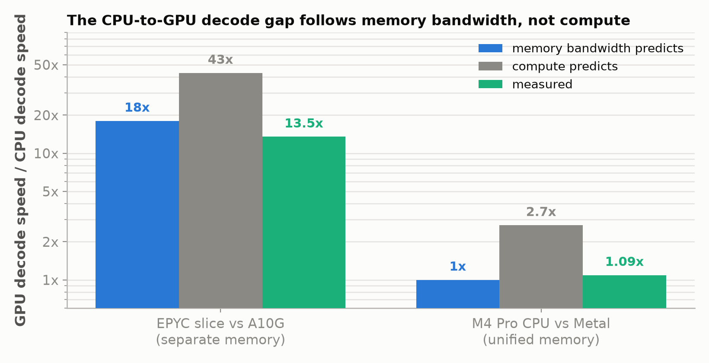

*Part 9 of "The Inference Wall", run off the series' usual rig: Qwen3.5-4B on two very
different CPUs, a cloud server slice and a MacBook, with each machine's own GPU alongside
for comparison. Draft.*

*Manas Pathak · draft, October 2026*

[The Inference Wall]({{ '/' | relative_url }}) · [All posts]({{ '/articles/' | relative_url }}) · **Part 9**

When I started learning about LLMs, I assumed that running one meant running it on a GPU.
Most of the tech coverage I read was about GPUs, and I took it for granted that a CPU was simply too slow for the matrix
arithmetic an LLM needs. The story turns out to be more nuanced than that, and it matters,
because CPUs are everywhere, in every laptop, phone, and server, often sitting idle and
rarely thought of as an AI platform. If the claim this series is built on is right, that
decode is limited by how fast memory can be read rather than by how fast the chip can do
math, then whether a CPU can run a model well should depend mostly on how fast it can read
memory. This post takes the same model and the same engine to two
CPUs with very different memory, a cloud server slice and a MacBook, each with its own GPU
alongside, and works out where a CPU is fine and where it is not.

The short answer is that it comes down to memory bandwidth rather than compute capacity.
On a MacBook with fast memory, the CPU runs the model within about 2.5x of a mid-range
datacenter GPU for one user. On a cloud
server slice with slow memory, the CPU is 13x behind. Where a CPU falls down is serving many users at once: a GPU can share one read of the
weights across a large batch of requests and keep getting faster, while a CPU soon runs
out of arithmetic and stops gaining.

The claim under test is the one from the [primer]({{ '/articles/primer/' | relative_url }})
and [Part 1]({{ '/articles/part-1/' | relative_url }}): to produce each token, the
machine reads the entire model's weights from memory once. Part 1 measured what that costs
on the A10G: a decode token took about 20 ms, nearly all of it the 19 ms needed to stream
the weights, while the arithmetic for that token would take
about 0.13 ms. Prefill is the
opposite case, because the whole prompt goes through in one pass and every weight read is
shared by all the prompt's tokens, so prefill time is set by the arithmetic. Written as
the time one decode token takes, the claim is a line with two terms:

```
time per token  =  weight bytes / memory bandwidth  +  fixed cost per token
```

The first term is the time it takes to stream the weights out of memory, set by how many
bytes the model is and how fast the memory bus moves them. It has nothing to do with how
fast the chip does math,
because at one request each weight is read once, used for one multiply-add, and
discarded; the arithmetic is finished long before the next byte arrives. The second term
is everything that does not scale with bytes: launching the work for each of the model's
layers, synchronizing threads, bookkeeping between tokens. On a big model and a slow bus
the first term is nearly the whole token and the second is a rounding error. Every result
below is one of three things happening to that line: the first term dominating, so the
gap between two chips is the gap between their memory buses; a kernel, the small program
that runs one operation on a chip, too slow to keep up with its bus, so the machine falls
off the line entirely; or batching, which shares the
first term across many tokens until the math, finally, is what binds.

This part is about the first term and about the regime where it stops being the
whole story; the second term, and what it does to small models and to unified-memory
machines, is Part 10. Three qualifiers apply throughout: the
measurements are one request at a time, with batching left to [Part 3]({{ '/articles/part-3/' | relative_url }}) on the GPU
and to the last section here on a CPU; every weight is read for every token,
which would not hold for a mixture-of-experts model; and the contexts are short, so the
per-token read of the conversation so far is small next to the weights.

## Two machines, chosen for their memory


The two CPUs were picked to be as far apart as possible on one axis, memory bandwidth,
and each sits next to a GPU so the CPU-to-GPU gap can be measured on the same box.

- **A cloud server slice.** An AWS cloud instance with 8 cores of an AMD EPYC server chip
  and the series' NVIDIA A10G. Its measured streaming bandwidth is **33 GB/s**. That is a
  slice of the socket's memory system, not the whole socket; a full EPYC socket with all eight of its memory channels in use delivers roughly
  200 GB/s. The CPU and the GPU sit on separate memory pools with a large cliff between
  them: the A10G's nominal bandwidth is 600 GB/s.
- **A MacBook.** An Apple MacBook with an M4 Pro chip, whose memory sits on a bus about as
  wide as a GPU's and whose GPU is on the same chip. Measured streaming bandwidth is **238 GB/s**, about seven times
  the server slice. Its CPU and GPU share the same
  physical memory and the same bandwidth. There is no cliff, by construction.

So the server slice has a CPU with modest memory bandwidth and a GPU with datacenter memory,
and the MacBook has a CPU and a GPU with identical memory. If decode is bandwidth-bound,
the CPU-to-GPU gap should be large on the first machine and close to 1x on the second,
and the MacBook's CPU should beat the server's CPU by about the bandwidth ratio.

The engine is [llama.cpp](https://github.com/ggml-org/llama.cpp), because it is the one
engine that runs the identical code on a CPU, an Apple GPU, and an NVIDIA GPU. The series' own engine was ruled out first: vLLM's CPU backend
has no kernel for Qwen3.5's linear-attention layers, so the same server cannot be pointed
at a CPU at all, a finding in its own right. The model is Qwen3.5-4B at several weight formats: the weights stored at 16 bits each, called F16 or bf16 depending on the number
format, or compressed to 8 or 4 bits each, Q8 and Q4 in llama.cpp's naming, so the file runs from 8.7 GB down to 3.0 GB. Prefill and decode are measured separately,
in tokens per second.

## The decode gap follows memory bandwidth

Each machine offers two competing predictions for how much faster its GPU should decode
than its CPU: the ratio of their memory bandwidths, or the ratio of their math rates.
The two predictions differ enough to tell apart.

| | Server slice + A10G | MacBook M4 Pro CPU + GPU |
|---|---|---|
| Bandwidth ratio predicts | 600 / 33 = **18x** | 238 / 238 = **1.0x** |
| Compute ratio predicts | **43x** | **2.7x** |
| Measured decode gap, same engine, same weights | **13.5x** at F16, 12.2x at Q4 | **1.01x** at F16, 1.09x across all formats |



On the server slice, bandwidth predicts 18x and the measurement is 13.5x, with the GPU
reaching about 79% of its nominal bandwidth in decode, which is in line with
[Part 1]({{ '/articles/part-1/' | relative_url }}). Compute predicts 43x, and that is
the generous reading: 43x compares the A10G's ordinary math rate, 31.2 trillion operations
a second, to the CPU's 0.72 trillion; the GPU's specialized matrix units run four times
faster still, which would make the compute prediction 174x. Either way compute is off by a factor of three or more and
bandwidth is the right frame.

On the MacBook the two engines share one memory bus, so bandwidth predicts no gap at all.
Measured with the CPU and GPU runs taken in alternating pairs, so each pair saw the same
chip temperature, the GPU decodes **1.09x** faster, the median of twelve pairs across four weight formats,
and in one of them the CPU won outright. With F16 weights alone, the case in the chart, the
two are within 1%. Compute predicts 2.7x, so two engines whose math rates
differ by 2.7x decode at nearly the same speed when they share a memory bus, which
is only possible if decode never depended on the math.

Prefill serves as the control. Because it is compute-bound, the GPU should keep its
advantage on the MacBook even though the memory is shared, and it does: GPU prefill is 2.9 to 3.5x the CPU's across the weight sizes, against the 2.7x compute ratio. Same machine, same memory, one phase closes to 1x and the other stays at 3x, which is
the compute-versus-bandwidth split seen on a single machine.

In the equation's terms, both machines are in the regime where the first term is nearly
the whole token, so the ratio of two chips' decode speeds is the ratio of their memory
bandwidths and nothing else. The server tests that with a large prediction, 18x, which is
hard to fake. The MacBook tests it with a null prediction, 1x, which many wrong models
would also make, so the MacBook's real evidence is the next section.

## Decode time is a straight line in bytes

The equation says time per token is a straight line in model size, with a steepness set
by the memory bandwidth, and the fixed cost as the intercept, where the line crosses the
time axis at zero bytes. That can be fitted
directly. Four weight formats on the M4 Pro, from 3.0 GB at 4 bits to 8.7 GB at 16 bits, run on both
engines and fit to the two-term line:


The slope of each line is one over the bandwidth, and reading the bandwidth off gives
**209 GB/s for the CPU and 205 GB/s for the GPU**, 88% and 86% of the measured 238 GB/s
ceiling. Refitting with the points drawn from different measurement rounds moves those figures by
under 1% at the median. Two engines with 2.7x different math rates decode on the same line, and that line's
steepness is the machine's memory bandwidth. The lines also have intercepts, the fixed
cost per token, and on the fast machine they are large enough to matter and tricky
enough to measure that they get a post of their own.

## Two byte-identical files

This is the cleanest measurement in the study. The model was saved in two 16-bit formats,
bf16 and F16. The two files are the same size to the byte, so the number of bytes read per token is
identical. The two formats split their 16 bits differently, with bf16 giving up precision for range, as
[this comparison of bf16 and fp16](https://www.beam.cloud/blog/bf16-vs-fp16) explains, but
for a bandwidth argument only the byte count matters: if decode is "read all the bytes," both files must decode at the same
speed on the same machine.

| machine | bf16 decode | F16 decode | F16 / bf16 |
|---|---|---|---|
| Server slice CPU | 4.0 tok/s | 4.0 tok/s | **1.01x** |
| MacBook M4 Pro CPU | 3.9 tok/s | 20.5 tok/s | **5.2x** |


On the server the two files do decode at the same speed, to within about 1%. On the
MacBook they do not: F16 decodes 5.2x faster, with the
hardware and the byte count held constant. The reason is software: llama.cpp has a fast hand-tuned vector kernel for F16 and only a slow generic path for
bf16 on this CPU. On the MacBook, decode from the bf16 file is bottlenecked on that slow kernel long before
it reaches the memory wall, at about 34 GB/s effective on a 238 GB/s machine. This is the
one case the equation does not cover: the bytes arrive faster than the kernel can consume
them, so the machine has fallen off the line and is limited by how fast it can execute
instructions rather than by memory. Compute matters here only as a threshold. A chip needs enough of it per byte
to keep up with its own bus, and once it has that, more buys nothing. Swap to the F16
file and the same bytes flow through a fast kernel, and decode jumps to 20 tok/s, 177
GB/s effective, back on the line at the memory wall.

Now look at the server row again. The same slow bf16 kernel runs there, and it costs
nothing, because the memory is slower than the kernel. Streaming 8.7 GB at 33 GB/s caps
decode at about 4 tok/s whatever the kernel does, so fixing the kernel buys nothing. The bf16 row on the server also runs at 34 GB/s effective, and it reads as a clean
confirmation that decode is at the memory wall, which it is. But a slow machine cannot tell the
difference between "at the memory wall" and "held back by a kernel that happens to run at
the same speed as the memory wall." The two explanations only separate on the fast
machine, and the F16 control is what separated them. An earlier version of this study cited that row as proof, and the conclusion was right,
but it could not be checked until the control ran on both machines. When a measurement lands exactly on a hardware ceiling, that agreement is evidence only
if the ceiling is high enough that a coincidence is unlikely, which is why fast hardware
is also the better measuring instrument.
Part 10 is about what else that instrument shows.

## The headline that says a MacBook beats a GPU

You may have seen the claim that a MacBook matches or beats a datacenter GPU at
LLM inference. The study's own numbers show where it comes from. The M4 Pro CPU decodes Q4 weights at about 52 tok/s, and the A10G decodes F16 weights at
55. Side by side, the MacBook CPU "matches" the GPU.

Those are different weight sizes. Q4 streams a quarter of the bytes per token that F16
does, so the comparison handed the MacBook a model that reads a quarter of the bytes and
the GPU one that reads four times as many. Hold the format fixed and the picture is
plain: at Q4 the A10G does 121 tok/s to the MacBook's 52, 2.3x ahead; at F16 it does 55 to 22, 2.5x ahead. The GPU wins at every format because it has more memory bandwidth and
decode is bandwidth-bound.

The result worth keeping is the one underneath: a MacBook CPU gets within 2.5x of a
mid-range datacenter GPU on single-user decode at all, and that closeness is the memory
bus. On the F16 file the M4 Pro CPU pulls 188 GB/s of effective decode bandwidth against
35 on the server slice. That is a 5.4x gap rather than the full 7.2x, because the slice
runs decode at its memory ceiling while the MacBook reaches about four fifths of its own. Part 10
looks at what else changes once memory is that fast.

## Many users at once

Everything above is one request at a time, and that is where a CPU looks best. Serving
many users is a different job, and [Part 3]({{ '/articles/part-3/' | relative_url }})
showed the trick a GPU uses for it. When several requests are in flight, the server reads
the weights once per step and uses that single read to produce the next token for every
request, so the cost of the read is split across all of them. That took the A10G from 49
to 1,091 tok/s, a 22x gain. A CPU can do the same thing, and the question is how far it
gets.

Sharing the read helps only while reading is the slow part. Each request still needs its
own arithmetic, so as the batch grows the read gets cheaper per token while the
arithmetic per token stays the same, and eventually the arithmetic is what the chip spends
its time on. The equation grows a third term to show it, with B the number of requests
sharing each read:

```
time per token  =  weight bytes / (B x bandwidth)  +  math per token / compute rate  +  fixed cost
```

With one request the middle term is tiny on any chip, which is why compute never mattered
above. How large a batch a chip can absorb before that term takes over depends on how much
arithmetic it can do for every byte it reads. A single request needs about one operation
per byte. The A10G can do about 50 per byte, the MacBook's CPU about 13, and the server
slice's CPU about 20, so the server CPU should gain up to about tenfold from batching and
then stall, at a ceiling 43x below the GPU's. Its prefill already hints at this, because a
512-token prompt also shares one read of the weights across many tokens: bf16 prefill runs
at 40 tok/s against 3.9 for one-at-a-time decode, a 10x gain.

Here is the measurement, taken the same way on the server slice's CPU and its A10G, with a
short prompt and 128 generated tokens per request, counting total tokens per second across
all requests:

| Concurrent requests | 1 | 2 | 4 | 8 | 16 | 32 | 64 | 128 |
|---|---|---|---|---|---|---|---|---|
| Server slice CPU, bf16 | 3.5 | 6.7 | 12.8 | 20.1 | 24.8 | 26.3 | | |
| Server slice CPU, Q4 | 9.2 | 15.0 | 19.9 | 21.6 | 25.2 | 26.1 | | |
| A10G, F16 | 54 | 93 | 158 | 252 | 360 | 443 | 514 | 552 |
| A10G, Q4 | 117 | 209 | 303 | 390 | 622 | 781 | 856 | 885 |


The CPU's gains run out quickly. The bf16 run speeds up 7.4x and the Q4 run 2.8x, and by
32 requests both have stalled at the same 26 tok/s. That convergence is the tell. For one
user, Q4 was 2.6x faster than bf16 because it has fewer bytes to read; once the read is
shared, the bytes stop mattering, the arithmetic sets the pace, and Q4's advantage
disappears. The GPU keeps going. It gains 8x by 32 requests and is still climbing at 128,
reaching 552 tok/s with F16 weights and 885 with Q4. The gap between the CPU and the GPU
grows from 15x with one request to 17x at 32 for F16, and to 21x for F16 and 34x for Q4 at
the point where the GPU is still gaining and the CPU has stopped.

So the answer to where a CPU is fine has two halves. For one user on a machine with fast
memory, a CPU decodes within a factor of two or three of a mid-range datacenter GPU, and
the gap is the memory-bandwidth gap. For many users, the gap grows toward the compute gap,
because once the read is shared the arithmetic sets the pace, and arithmetic is where the
GPU is far ahead. A CPU can run a model well for one person, and it cannot serve a crowd.

## What to take away

1. **One line explains the dynamics: time per token is weight bytes over memory
   bandwidth, plus a fixed cost.** At one request the arithmetic never enters. Compute
   matters only as a threshold a kernel must clear to keep up with its bus, and as the
   term that takes over once batching shares the weight read.
2. **The CPU-to-GPU decode gap is the memory bandwidth gap.** 18x predicted and 13.5x
   measured on a box with a bandwidth cliff; 1.0x predicted and 1.09x measured on a box
   without one. Compute predicts 43x and 2.7x and is wrong on both.
3. **Decode time is a straight line in weight bytes whose steepness is the bandwidth.** On
   the M4 Pro the CPU and GPU lines read 209 and 205 GB/s against a 238 GB/s ceiling, with
   2.7x different math rates.
4. **A low ceiling can confirm a wrong explanation.** Two byte-identical files decode about 1.01x apart on the slow machine and 5.2x apart on
   the fast one. Only the fast one could show that a kernel rather than memory set the speed.
5. **"MacBook beats GPU" compares different weight sizes.** At matched format the A10G
   leads the M4 Pro CPU by 2.3 to 2.5x. The remarkable part is that a CPU is that close
   at all, and the reason is the memory bus Apple put under it.
6. **A CPU is fine for one user with fast memory, and not for a crowd.** Batching lifts
   the server CPU 2.8 to 7.4x depending on format and then hits its math ceiling at 26 tok/s, where bf16 and Q4
   converge; the GPU is at 552 and still climbing.

---

*Reproduce: both machines ran `llama-bench` from llama.cpp, build 458681e on the server
slice and dfc29b6 on the M4 Pro, on `Qwen/Qwen3.5-4B` GGUFs at bf16, F16, Q8_0, and
Q4_K_M, plus Q6_K on the M4 Pro; the batched runs used `llama-batched-bench` on the
server slice and the A10G only. The F16 file was produced from the bf16 file with
`llama-quantize`, which is why the two are byte-identical at 8,665,620,192 bytes each. CPU runs use `-ngl 0`, Metal
runs `-ngl 99`, CUDA runs `-ngl 99`. The M4 Pro CPU-versus-GPU ratio interleaves the two
engines round-robin so each pair runs at the same chip temperature, because absolute
speed on the MacBook drifts by up to 20% over a long session. The microbenchmarks, bench
drivers, and figure renderer are in
[`experiments/09-cpu-decode/`](https://github.com/mapathak-commits/inference-wall/tree/main/experiments/09-cpu-decode);
the raw bench tables, JSONL, and the Mac study's audit ledger are in
[`benchmarks/09-cpu-decode/`](https://github.com/mapathak-commits/inference-wall/tree/main/benchmarks/09-cpu-decode).
Both folders also hold Part 10's data. Absolute numbers are specific to a g5.4xlarge
slice and one M4 Pro; the predictions and their outcomes are not.*

---

**Previous:** [Part 8: FlashAttention]({{ '/articles/part-8/' | relative_url }}) · **Next:** Part 10, coming soon · [All posts]({{ '/articles/' | relative_url }})

---

*Disclaimer: This blog is written and published in my personal capacity. The opinions,
findings, and conclusions expressed herein are solely my own and do not necessarily
represent the views, policies, or endorsements of my current or past employers.*
